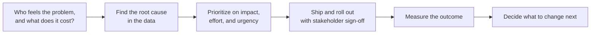

# Deepesh Vanjani — Product Manager Portfolio

**Product Manager focused on reconciliation, financial controls, and fraud analytics for fintech and payments**

[Resume](resume/Deepesh_Vanjani_Product_Manager_Resume.pdf) · [LinkedIn](https://www.linkedin.com/in/deepeshvanjani/) · [Email](mailto:vanjanideepesh@gmail.com)

---

> [!NOTE]
> All data in this repository is synthetic. Where a case study draws on work I did during employment, I reconstruct the decisions and methodology, not the original files, findings, or figures.

## What this repo is
Three product case studies, each written the way I would walk a hiring manager through it: who felt the problem, how I framed and prioritized the options, what I shipped and how I rolled it out, what changed, and what I would do differently.

## At a glance
| Case study | The problem | What I owned | Outcome |
|---|---|---|---|
| [Reconciliation Process Automation](reconciliation-process-automation/) | Month-end reconciliation across five systems depended on one person's manual VLOOKUP work | Problem framing, sequencing, and delivery | About 4 hours cut to about 4 minutes; 70,199 line items at 99.99% accuracy |
| [Balance Sheet & P&L Automation](balance-sheet-automation/) | A 7-year-old financial model broke silently during the monthly close | Root-cause diagnosis, the fix, and the rollout plan | Recurring data-bleed errors removed; model now updates from Trial Balance postings |
| [Forensic Audit: Manual Order Fraud Detection](forensic-fraud-framework/) | Manually created replacement orders were an invisible place for abuse | Detection design and the leadership narrative | Multi-signal framework (synthetic demo); the real work informed policy enforcement |

## How I approach a product problem

- **Fix the highest-exposure item first, even when it is not the cheapest.** (Reconciliation)
- **Treat a rollout as part of the product, not an afterthought.** (Balance Sheet & P&L)
- **A finding only has value once someone can act on it.** (Fraud detection)
- **A mismatch is a product signal, not just a cleanup task.** (Reconciliation)

## About me
I'm a Product Manager who does my best work where a product decision depends on whether the underlying data is right: reconciliation, financial controls, fraud detection, and the operational systems behind payments and finance.

**Product experience.** From December 2023 to June 2026 I was the Product Manager of a founder-led venture in Indian music-tech. I identified a $5M market opportunity, secured Government of India validation with a ₹3.6 lakh grant, and owned the roadmap and MVP delivery for a six-member team. I prioritized the backlog with MoSCoW, ran sprint planning, standups, and retrospectives (cutting time-to-market by 30%), and defined the go-to-market across two launches, growing adoption to 200+ users. The product shipped at TRL-5 and reached 10+ paying customers and $125K in annual revenue, with 87% task completion and a +42 NPS.

**Why financial systems.** In July 2026 I joined The Sleep Company as a Data Analyst (Associate) in finance, to build hands-on depth in financial systems, data, and controls ahead of a move into fintech product roles. There I automated a five-system reconciliation, rebuilt a seven-year-old Balance Sheet & P&L model, and led a forensic audit whose report informed policy enforcement. Those three projects are the case studies in this repo.

**How I work.**
- I start with who feels the problem and what it costs them, before choosing a solution.
- I prioritize on impact, effort, and urgency, and I am explicit about what I am deferring and why.
- I treat rollout as part of the product: parallel runs, stakeholder sign-off, and a plan to retire the old process.
- I write for the person who has to act: the decision, the evidence, and the ask.

**Tools.** SQL (BigQuery), Python, Excel VBA, SAP, Jira, Figma.

**Credentials.** MBA (Finance), COEP Technological University, 2024 · B.Tech, Vellore Institute of Technology, 2021 · Professional Scrum Master I (Scrum.org) · Google Project Management Certificate.

**What I'm looking for.** Product Manager and Associate Product Manager roles in fintech, payments, and banking, especially reconciliation, settlements, payment operations, and risk and fraud products. Mumbai, Pune, Delhi NCR, or remote.

## Contact
[vanjanideepesh@gmail.com](mailto:vanjanideepesh@gmail.com) · [LinkedIn](https://www.linkedin.com/in/deepeshvanjani/) · [Resume](resume/Deepesh_Vanjani_Product_Manager_Resume.pdf)
