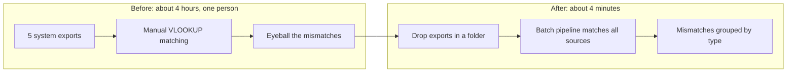

# Reconciliation Process Automation

> **In one line:** Monthly reconciliation across five systems took about 4 hours and depended on one person's manual work. I scoped, sequenced, and automated it into a pipeline that runs in about 4 minutes and reconciles 70,199 line items at 99.99% accuracy.

**My role:** problem framing, prioritization, and delivery · **Context:** finance operations at a D2C retail company · **Stack:** SQL (BigQuery), Excel VBA, batch scripting

---

## 1. The problem and who felt it
At a fast-growing D2C retail company, monthly reconciliation (Settlements, Sales, and related cycles) meant manually pulling exports from five separate systems into one Excel workbook, matching them with VLOOKUP, and eyeballing the mismatches. The five sources were SAP, an internal Order Management System (via BigQuery), POS, a marketplace/central-store portal, and a fulfillment system.

The people who ran it felt the cost every month: it was slow, error-prone, and entirely dependent on one person's manual attention.

## 2. What success looked like
| Dimension | Starting point | Target |
|---|---|---|
| Turnaround | About 4 hours per month | Minutes |
| Accuracy | Manual matching, mismatches eyeballed | Every line item matched and counted |
| Investigation | One undifferentiated list | Mismatches grouped by root cause |

## 3. Prioritization: what to automate first
Automating reconciliation was not a single build; it was a sequencing decision. With one engineer's time and four-plus reconciliation types that all needed the same treatment, I weighed **impact** (hours saved, error risk) against **effort** (shared logic, system complexity) and **urgency** (audit exposure).

| Reconciliation | Why it landed here | Decision |
|---|---|---|
| Settlements | Highest revenue-linked error risk and the most audit scrutiny | Automated first: fix the highest-exposure item first, even if it is not the cheapest |
| Sales and Unicommerce sync checks | Shared most of the underlying logic with the core pipeline | Followed together once the core pipeline existed |
| Lower-volume marketplace channels | Lower exposure | Deliberately deferred, sequenced behind higher-impact work |

Full breakdown: [`artifacts/rollout_prioritization.csv`](artifacts/rollout_prioritization.csv)

## 4. What I shipped
- A **folder-driven batch pipeline**: exports go into a fixed input folder structure, a script processes them automatically, and a structured output workbook is generated, with no manual copy-paste.
- **Mismatches auto-segmented by type** (present in System A only, System B only, cross-channel discrepancies), so root-cause review takes minutes instead of hours.
- A **summary tab** that surfaces the numbers that matter first: total orders processed, total value, and the mismatched subset and its value, before anyone opens a detail tab.

## 5. What I found along the way
Beyond the automation, the structured approach surfaced two data-integrity issues that manual review had missed for a long time:
- A **duplicate join-key** in one system's extract (two rows sharing a key, whose values summed correctly against the other system), which is easy to miss by hand and obvious once automated.
- Roughly **0.2% of orders silently failing to sync** between systems because of a null date field upstream.

A mismatch is a product signal, not just a cleanup task. Both were small structural bugs that compound expensively if nobody is specifically looking for them.

## 6. Outcome
| Metric | Before | After |
|---|---|---|
| Turnaround time | About 4 hours per month | About 4 minutes per month |
| Line items reconciled | Manual VLOOKUP matching across five sources | 70,199 at 99.99% accuracy |
| Mismatch investigation | Undifferentiated list | Auto-segmented by root cause |

## 7. What I would do differently
Given more runway, I would move this from a batch, folder-driven script to a scheduled pipeline with alerting (for example, Airflow plus a Slack notification on mismatch-rate spikes), so someone learns about a data-integrity issue the day it happens, not the day the monthly reconciliation runs.

## Files in this folder
- `scripts/`: the batch-processing logic (recreated with synthetic data; structure and approach match the original)
- `sample-data/`: synthetic input files showing the expected format from each source system
- `assets/`: sample output workbook screenshot
- `artifacts/`: the prioritization breakdown
